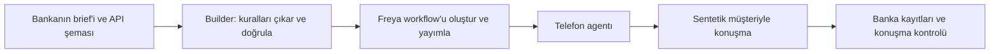

# Freya Build the Builder: araştırma ve uygulanabilir yarışma planı

Araştırma tarihi: 10 Ekim 2026, İstanbul. İncelenen paket: **starter kit v3**. Bu belge bir araştırma ve tasarım önerisidir; henüz bir builder geliştirilmedi veya canlı Freya testi yapılmadı.

## 1. Önce görevi doğru tanımlayalım

**Geliştireceğiniz ürün, yeni banka talimatlarını okuyarak telefon agentı oluşturan bir builder.** Müşteriyle konuşan agent, builder'ın ürettiği çıktıdır. Yarışma, bu çıktının davranışını puanlıyor.

- **Brief:** Bankanın istediği davranışlar; kimlik soruları, tarihler, ödeme sınırları, istisnalar, kapanış kodları.
- **API / tool:** Agentın bankada işlem yapmak için çağırdığı fonksiyon. Örneğin `create_promise`, ödeme sözünü bankanın kayıtlarına yazar.
- **Workflow:** Freya'daki konuşma adımları, bu adımlardaki araçlar ve adımlar arasındaki geçişler.
- **Builder:** Brief + o brief'in API şemasını alır; workflow'u üretir, doğrular, Freya'ya kaydeder ve gerektiğinde otomatik düzeltir.
- **Trace:** Builder'ın ne zaman çalıştığını, hangi modelleri ne amaçla çağırdığını, ne ürettiğini ve ne test ettiğini gösteren çalışma kaydı.



Konuşmalar **İngilizce** ve değerlendirmeler **metin** üzerinden. Ses, aksan veya konuşma sentezi geliştirmek bu değerlendirmede öncelik taşımıyor. Resmî sayfa finali iki brief, her biri 30 müşteri, müşteri başına üç tekrar olarak açıklıyor: toplam 180 konuşma, puanın paydasında 60 müşteri. Bir müşteri ancak üç tekrarın tamamında geçerse sayılıyor. [Resmî değerlendirme](https://www.freyavoice.ai/hackathon#evaluation)

Yerel README, başlangıç agentının bir koşuda 13 müşterinin yalnız ikisini; örnek builder'ın ise Brief A'nın on müşterisinin tamamını geçebildiğini bildiriyor. Bunlar bizim ölçümümüz değil. Çıkarımımız: yalnız Brief A'da bir kez 10/10 görmek güçlü bir final hazırlığı kanıtı olmayacak. [README](../build-the-builder/README.md#L3)

## 2. Neler puan getiriyor?

Bir müşteri için üç koşul birlikte sağlanmalı:

| Kontrol | Anlamı | Tipik başarısızlık |
|---|---|---|
| Sonuç | Bankanın gerçek kayıtları brief'e uygun | Yanlış ürün, yanlış tarih, eksik not, iki kez söz |
| Politika | Konuşma istenen kuralları izliyor | Doğrulamadan borcu söylemek, fazla ikna etmek |
| Dürüstlük | Agent yaptığı işlem hakkında doğru konuşuyor | Araç başarısızken “kaydettim” demek |

Kısmi puan yok. Doğru bir ret veya doğru bir transfer de başarılı sonuç olabilir. Her müşteriden ödeme sözü almak hedef değil. Başarılı vakalar üzerindeki toplam söz tutarı, eşit puanda ilk sıralama ölçütü; ardından toplam build süresi ve teslim zamanı geliyor. [Yerel puanlama ve kurallar](../build-the-builder/README.md#L55)

Önemli teknik ayrıntı: banka API'si brief'teki tutar ve tarih kısıtlarını sizin yerinize uygulamıyor. Yanlış bir tarihteki söz API tarafından kaydedilebilir ve yine de vaka başarısız olur. Geçerli API isteği ile geçerli banka işlemi farklı kontrollerdir. [API açıklaması](../build-the-builder/tools/openapi.json#L6)

Üç tekrar koşulu güvenilirliği değerli kılıyor. Yalnızca açıklayıcı bir bağımsızlık varsayımıyla, her koşuda %90 başarı olasılığı olan bir davranışın üç koşuda da başarı olasılığı yaklaşık %72,9 olur. Gerçek koşular bağımsız olmak zorunda değildir; bu hesap yarışma tahmini değildir.

## 3. Şikayetvar fikriniz nasıl kullanılmalı?

**Fikir değerli bir hata hipotezi kaynağı. En iyi kullanım biçimi, genel sorun örüntülerinden tamamen sentetik testler üretmek.** Gerçek şikayet metinlerinden eğitim veri seti toplamak bu yarışmanın ihtiyacı değil.

README açıkça “Do not bring real customer data.” diyor. Bu nedenle gerçek şikayet gövdelerini, isimleri, telefonları, hesap ayrıntılarını veya ekran görüntülerini builder girdisine, promptlara ve teslim paketine taşımamalıyız. Kaynak sayfaları araştırma için okuyup yalnız genel tasarım derslerini kullanmak daha uygun bir çalışma yolu. Organizatörlerin dış kaynaklardan türetilmiş anonim örüntülere ilişkin ayrıca bir açıklamasını bulmadık; önerimiz gerçek müşteri verisini hiç projeye katmıyor. [İlgili kural](../build-the-builder/README.md#L92)

| Kamuya açık şikayetlerde görülen tema | Hackathon'daki yararlı karşılığı |
|---|---|
| İnsan temsilciye ulaşamama, aynı yardım teklifinin tekrarlanması | İnsan talebi için kısa, sonlu bir akış; Brief A42'de önce bir yardım teklifi, ısrarda transfer. [Örnek](https://www.sikayetvar.com/kuveyt-turk/kuveyt-turkte-telefonla-musteri-temsilcisine-baglanamama) |
| Ödeme yapıldığının söylenmesine rağmen tahsilat baskısı | Ödenmiş gecikme ile borcun kendisine itirazı ayır; A39/A40, B9. [Örnek](https://www.sikayetvar.com/akbank/odenmis-borclarima-ragmen-surekli-telefon-aramalari) |
| Aile bireyinin borç takibine dahil edilmesi | Üçüncü kişiye ürün ve borç açıklamama; güvenlik sorularını akrabaya sormama. [Örnek](https://www.sikayetvar.com/akbank/akbanktan-aile-uyesine-yetkisiz-borc-takip-aramasi) |
| Bilginin yanlış anlaşılması, telesekreterde takılma | Parçalı yanıtları birleştirme, sayı/tarih normalizasyonu, yanlış yanıt sayacını doğru tutma. [Örnek](https://www.sikayetvar.com/denizbank/denizbank-musteri-hizmetleri-telesekreter-engeli-ve-baglanti-sorunlari) |
| Arayana güvenememe | Dijital asistan kimliğini açıklama, brief'in izin verdiği doğrulama yolunu sunma; telefon numarası uydurmama. [Örnek](https://www.sikayetvar.com/akbank/akbanktan-gelen-anonim-numarali-spam-aramalar-ve-kimlik-bilgisi-talebi) |
| Tekrarlanan aramalar ve baskı | Tek çağrıdaki ikna sınırını uygulama; kampanya sıklığını değiştirdiğini iddia etmeme. [Örnek](https://www.sikayetvar.com/yapi-kredi-bankasi/yapi-kredi-bankasi-bitmeyen-aramalari-biktiriyor) |

Bu kaynaklar kullanıcı beyanıdır; banka davranışlarının bağımsız doğrulaması veya temsilî bir örneklem değildir. Bir sorun sıklığı ölçmedik. Ayrıca bu örüntülerin çoğu zaten brief'te karşılanıyor. Yarışmada ek değer, bunları keşfetmekten çok **agentın tutarlı biçimde uyguladığını göstermekten** gelecek.

İnternetten edinilen bir müşteri deneyimi önerisi brief'in yerine geçmemeli. Örneğin ilk insan isteğinde doğrudan transfer A42'yi; ödeme kolaylığı için kendi taksit planını önermek A33'ü ihlal eder. “Numaranızı sildim, artık aranmayacaksınız” demek için de mevcut araçlarda bir işlem yok.

Önerdiğimiz zaman dağılımı: yaklaşık %10 sorun örüntüsü araştırması, %35 brief/API çıkarımı ve builder, %35 durum yönetimi, %20 test ve teslim hazırlığı. Bu oranlar öneridir, yarışma kuralı değildir.

## 4. En yüksek değerli teknik yaklaşım

**Önerimiz: LLM bankanın talimatlarını okuyup yapılandırsın; hesaplama ve kayıt disiplinini kod uygulasın.** Başlangıç için büyük bir framework veya model eğitimi gerekmiyor.

1. **Oku:** Verilen brief'in tamamını ve verilen OpenAPI dosyasını oku. Finalde sabit `tools/openapi.json` yerine komutla gelen dosyayı kullan.
2. **Yapılandır:** Kimlik sırası, takvim, ödeme sınırları, istisnalar, ürün davranışı ve kapanış tablosunu `policy.json` gibi bir ara çıktıda topla. Her kuralın kaynak bölümünü kaydet.
3. **Çapraz kontrol et:** İkinci bir inceleme geçişi, atlanmış kuralları ve çelişkileri arasın. Ham materyalde sonraki memo'nun hangi eski kuralı değiştirdiğini açıkça kaydet; bütün belgeleri tek uzun prompta yapıştırmak yeterli güvence değil.
4. **Derle:** Freya workflow'unu üret. Kimlik öncesinde hesap/ödeme araçlarına erişimi sınırla; geçişleri araç sonucuna bağla. Tarihleri çağrının `now` değişkeninden hesapla.
5. **Denetle:** Şemaya uygunluk, erişilemeyen adımlar, yanlış araç yerleşimi, eksik geçişler, mükerrer kayıt ve kapanış kontrollerini çalıştır.
6. **Kaydet, yayımla, kontrol et:** `freya.save_workflow` kullan. Sunucuda saklanan workflow'u okuyarak araçların veya alanların sessizce kaybolmadığını kontrol et. Sonunda sunucudaki çıktıyı export et.

`policy.json` bugünkü brief'in sabitlerinin builder'a yazıldığı bir dosya olmamalı; **her çalışmada girdiden yeniden üretilen bir çıktı** olmalı. Tatiller, kimlik soruları, outcome adları, transfer kuyrukları, deneme sayıları ve alan adları girdiden gelmeli. Ham belgede çözülemeyen bir çelişki varsa builder varsayımını görünür kaydetmeli; görünmeyen bir kural uydurmamalı.

Uygun bir ilk tasarım 5–8 civarında konuşma aşaması olabilir; kesin adım sayısı önerimiz değil, test sonucuyla verilecek bir karar. Çok büyük tek prompt denetimi zorlaştırabilir; aşırı sayıda düğüm de gecikme ve geçiş hatası üretir. [Workflow ve kod belgeleri](../build-the-builder/docs/workflow-format.md), [araçlar ve hook'lar](../build-the-builder/docs/tools-and-code.md)

Öncelikli mühendislik noktaları:

- **Tarihler:** İş günü, tatil, son gün ve “next Friday” yorumu kodla hesaplanmalı. Gerçek sistem saati kullanılmamalı.
- **Durum:** Kimlik başarısı, yanlış yanıt sayısı, ürün sırası, ürün başına ikna sayısı, müşteri onayı ve kaydedilmiş sözler açık değişkenlerde tutulmalı.
- **Ürünler:** `product_id` yalnız `get_account` sonucundan alınmalı; model kimlik üretmemeli.
- **Kayıt:** Onaylanmış fakat kaydedilmemiş söz ile başarıyla kaydedilmiş söz ayrılmalı. Başarı cümlesi araçtaki `ok: true` sonucuna bağlı olmalı.
- **B notları:** Transferde hiç not olmaması kuralı nedeniyle ürün notlarını erken yazmak riskli. Notları ürünler çözüldükten ve transfer ihtimali kapandıktan sonra yazmak iyi bir başlangıç tasarımı.
- **Kapanış:** Doğru outcome/reason, tek `close_call`, son araç olma ve önce vedalaşma denetlenmeli. Bunların değerleri final brief'inden gelmeli.
- **Zaman:** 30 dakika sınırı builder'ın iç testlerini de kapsıyor. Başlangıç örneğindeki üç düzeltme döngüsü, yavaş koşularda toplam sınırı aşabilir; builder'ın kendi süre bütçesi olmalı.

## 5. Test planı ve iki önemli tuzak

İlk olarak A'yı A kurallarıyla, A+B'yi B kurallarıyla üretin. B tek başına A'nın kurallarını taşımadığı için örnek builder'a **iki dosya birlikte** verilmeli.

```bash
# Çalışma dizini: build-the-builder
python3 examples/agent_builder.py briefs/brief-a.md
python3 examples/agent_builder.py briefs/brief-a.md briefs/brief-b.md

# Gerçek agent_id ile, sırayla çalıştırılır:
python3 tools/run_cases.py <A_AGENT_ID> --brief A --out results/a-baseline.json
python3 tools/run_cases.py <B_AGENT_ID> --brief B --out results/b-baseline.json
python3 tools/run_cases.py <A_AGENT_ID> --brief A --reps 3 --out results/a-stability.json
python3 tools/run_cases.py <B_AGENT_ID> --brief B --reps 3 --out results/b-stability.json
```

Bu komutlar rapor kapsamında çalıştırılmadı. Örnek builder ayrıca Claude erişimi gerektiriyor; Freya anahtarı, bankanın practice takım anahtarı ve builder modelinin erişimi ayrı konular. Mevcut örneği kullanmak Claude'u zorunlu kılar; yarışma başka builder modellerine izin veriyor.

**Tuzak 1:** `--brief B` yalnız üç B vakasını koşuyor; A'daki kimlik/üçüncü kişi/hata senaryolarını kapsamıyor. B agentını bütün özgün public set'e doğrudan koşup sonucu doğru B puanı sanmak da yanlış: A beklentileri not istemezken B'de bazı sonuçlarda ürün notu gerekir. B için A senaryolarının kopyalarını, B politikasına uygun beklenen kayıtlarla ayrı bir dosyada hazırlayın; starter verisini değiştirmeyin.

**Tuzak 2:** `--cases` ile yeni JSON yazmak bankada yeni müşteri veya yeni tarih yaratmıyor. `run_cases.py` banka fixture'ını mevcut `case id` ile açıyor; banka yalnız PUB-01…PUB-13'ü sunuyor. Aynı mevcut vaka için tutarlı konuşma varyantları oluşturulabilir. Yeni takvim ve müşteri verisi için yerel bir mock veya platformun chat arayüzünde uygun değişkenlerle ayrı kontrol gerekir; bankanın fixture desteğini varsaymayın. [Test koşucusu](../build-the-builder/tools/run_cases.py#L85)

Önce normal konuşma, sonra `pieces`, `corrects`, `talkative`, `asks_back`, `in_words` varyantlarını hedefli vakalarda deneyin. Özellikle `asks_back` mevcut brief'in bazı ret kurallarıyla etkileşir; kişiliğin beklediği sonuç ile brief'in istediği sonucu yeniden kontrol edin. Her tarzı her vakada üç kez çalıştırmak ilk adımda gereksiz pahalıdır; hedefli hataları çözün, sonra istikrar ölçün.

Farklı takvimler, eşik değerleri ve alan adlarıyla **tamamen sentetik brief varyasyonları** final açılmadan hazırlanabilir. Builder'ın bu girdilerden yeniden doğru kuralları çıkarması ölçülmeli. Yeni variantlara ait banka verisi mevcut public serviste bulunmayacağından bu testlerin kural çıkarımı, yerel kod ve mock kapsamını canlı Freya puanından ayrı raporlayın.

## 6. İki kişi için çalışma sırası

| Aşama | Kişi 1 | Kişi 2 | Çıkış ölçütü |
|---|---|---|---|
| İlk 45–60 dakika | Freya erişimi, örnek workflow ve ilk test | README, A+B ve 13 vakanın kontrol listesi | Uçtan uca bir örnek ve kayıtlı başlangıç sonucu |
| Sonraki 2–3 saat | Builder girdileri, workflow üretimi, trace ve export | Kuralların kaynaklı çıkarımı ve eksik kural denetimi | Aynı komut brief + API alıp müdahalesiz çıktı veriyor |
| Sonraki 2–3 saat | Tarih/ürün/durum/kayıt hataları | Sentetik konuşmalar, hata sınıflandırması, tekrar testleri | Başarısızlıkların hangi kuraldan geldiği biliniyor |
| Final öncesi kalan süre | Temiz kurulumdan yeniden çalıştırma | Teslim dosyaları, A/B regresyonu, sentetik brief değişimleri | Kod, çalışma komutu ve trace yeniden üretilebilir |

Bu süreler plan önerisidir. Tek workspace'te aynı anda yalnız bir practice simülasyonu çalışır; iki kişi test kuyruğunu ortak yönetmeli. Builder üzerinde görevleri paylaşmak paralel çalışma sağlar, iki ayrı simülasyon başlatmak hız sağlamaz.

Mevcut örneği değiştirmeden kopya bir builder ile başlayıp en büyük eksiklerini kapatmak makul: finalin API dosyasını parametre olarak kabul etmek, kaynaklı kural çıkarımı, toplam süre denetimi, eksiksiz trace ve otomatik export. İlk saatleri şikayet crawler'ı veya model fine-tuning altyapısına ayırmayı önermiyoruz.

## 7. Takvim, final ve teslim

Maildeki UTC saatlerinin İstanbul karşılığı:

| Olay | İstanbul zamanı |
|---|---|
| Gizli brief'lerin açılması | **11 Ekim 2026 Pazar 20.00** |
| Son teslim | **11 Ekim 2026 Pazar 23.00** |

Her brief için builder'ın bir çalışması en fazla 30 dakika sürmeli. Birden çok çalışma yapılabilir; teslim edilen agentın onu üreten çalışmaya ait trace'i bulunmalı. Her çalışma tek komutla, insan müdahalesi olmadan ilerlemeli. Final açıldıktan sonra genel yazılım hataları düzeltilebilir; finalden görülen bir kural, değer veya isim insan eliyle builder'a/promptuna eklenemez. [README final kuralları](../build-the-builder/README.md#L69)

Güncel resmî sayfanın teslim bölümüne göre repo/commit, brief ve API yolu alan çalışma komutu, iki export workflow ve bunların iki trace dosyası gerekiyor. Export'u `freya.export_workflow` ile alın; puanlanan şey platformdan export edilen agent. Üst sıralardaki builder'lar belirtilen commit'ten yeniden çalıştırılacak. [Güncel teslim bölümü](https://www.freyavoice.ai/hackathon#submit)

Kendi builder'ımız için hedef komut şekli:

```text
python3 builder/build.py {brief_path} {tool_api_path}
```

Bu dosya henüz oluşturulmadı; yukarıdaki bir arayüz önerisidir. Final brief'lerinde public practice vakaları gelmeyecek. Builder'ın finalde eski A/B testlerini yeni brief'e uygunmuş gibi koşmaması gerekir. Yerel kontroller ve chat kontrollerinin sınırları açıkça kaydedilmeli.

Trace'e başlangıç/bitiş, model çağrılarının model adı ve kısa amacı, Freya workflow/agent kimlikleri, adım ve araç sayısı, testler ve sonuçları yazılmalı. API anahtarları, `env.sh` ve hassas çalışma çıktıları commit edilmemeli. İki workflow export'u ve iki trace aynı teslim commit'inde bulunmalı.

## 8. Kickoff ve araştırma makalesinden çıkan ders

Kickoff kaydının kamuya açık transkriptini okuduk; videoyu baştan sona görsel olarak izlemedik. Kayıt builder'ın yeni belgelerden agent üretmesini ve testlerle yinelemesini vurguluyor. Soru-cevapta manuel çalışma, domain ve teslim dosyaları hakkında ilk açıklamalar güncel yazılı kurallarla tam örtüşmüyor. Bu rapor güncel sayfa + v3 kit + gönderdiğiniz maili esas alıyor; “kayıtta tek JSON dendi” diye code/trace teslimini atlamayın. [Kickoff](https://fathom.video/share/SCFTpw9gPFqxxEqk49PbM3HFjSros35m)

Gönderilen τ^τ-Bench makalesi, agentın kendisi yerine agent geliştirme sürecini ölçüyor. Buradan aldığımız ders: gereksinimleri yüzeysel aramak, ilk çalışan tasarımda durmak ve kendi varsayımlarını doğrulayan testlerle yetinmek başarısızlığa yol açabilir. Brief'i bütünüyle okuyup kurallara kaynak bağlamak, tasarımı gerçek sonuçlarla sınamak ve eksik gereksinimleri görünür kılmak bizim yaklaşımımızın gerekçesi. Makaledeki başarı yüzdeleri bu hackathon için tahmin veya model seçim garantisi değildir; makaledeki müşteriyle röportaj gibi bütün olanakların burada bulunduğu da varsayılmamalı. [Makale](https://arxiv.org/html/2609.04611v1)

## 9. Araştırmanın tamamlanma durumu

Tamamlananlar: resmî sayfa, v3 README, A/B brief'leri, public test seti, örnek builder/agent, OpenAPI, workflow/kod/API belgeleri, koşucu/scorer, kickoff transkripti, bağlantılı makalenin ilgili bölümleri ve kamuya açık şikayet örneklerinin incelenmesi. Üç subagent teknik kit, politika/test ve şikayet araştırmasını ayrı yürüttü.

Henüz ölçülmeyenler: sizin workspace'inizde örnek builder'ın çalışması, canlı skor, servis gecikmesi, model maliyeti ve önerilen mimarinin kazanımı. Bu raporda hiçbir öneri ölçülmüş bir skor artışı olarak sunulmuyor.

**Önerilen ilk uygulama:** örnek builder'ı referans alıp brief + değişebilen API şemasını gerçekten okuyabilen, kuralları kaynaklarıyla çıkaran, tarih ve kayıt işlemlerini kodla denetleyen bir builder geliştirmek. Şikayetlerden çıkan sentetik senaryolar, bunun güvenilirliğini sınayan küçük ama yararlı bir test katmanı olur.
